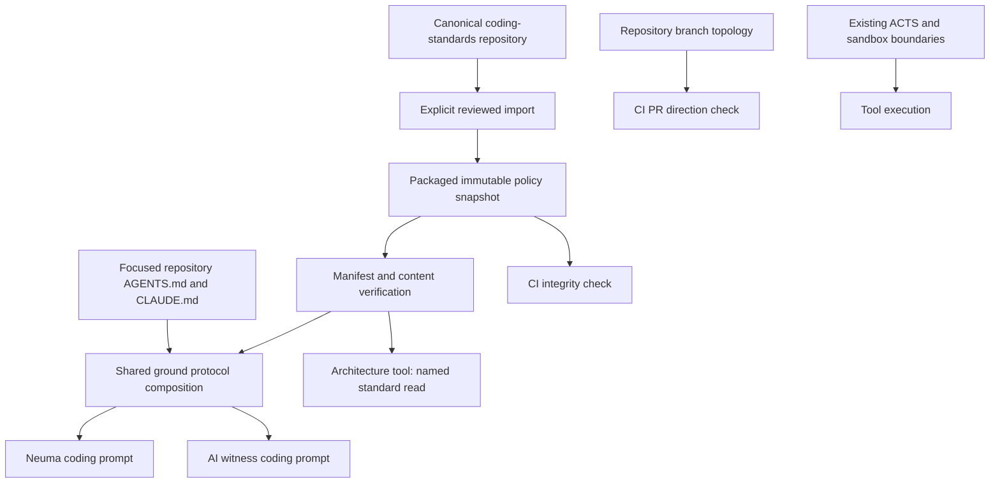

# Coding standards in Neuma's architecture

Status: implementation in this working tree, 2026-09-07. Owner: Codex GPT-6.
Authority: Founder's request to incorporate `/workspace/repos/project-kofemim/`
into Neuma's core architecture. This is platform infrastructure in `backend/`;
it does not alter a neuma's identity, DNA, standing, or sovereign workspace.

The coding standards are a shipped platform dependency. Every coding seat with
an opened ground receives a compact operating guide and policy identity, followed
by that ground's own protocol. The exact core is loaded once through
`map/read_architecture {"standard":"CORE"}`; applicable standards are then read
by name as needed. After context loss or policy change, reload the needed rules.
Executable checks enforce specific properties; delivery of prose is never
reported as proof that a model follows it.

## Ownership and dependency direction



- **Canonical policy:** the sibling coding-standards repository, version 2.0.0
  at adoption, 2.4.0 now (DESIGN joined the core in 2.2.0; 2.3.0 added the less-to-read rule, which 2.3.1 corrects to […]; 2.4.0 adds "show, don't tell"). Maintain semantic changes there; Neuma consumes an explicit pin.
- **Packaged copy:** `backend/services/coding-standards/bundle/`. Its 19 Markdown
  files are byte-identical to the source. `source-manifest.json` preserves the
  original inventory and routing. `manifest.json` records module hashes plus a
  content digest covering the original manifest and ordered module contents.
- **Loader:** `bundle.js` validates schema, names, routing, source digest, every
  module hash, and exact inventory. Reads are bounded, regular files only;
  invalid or missing policy throws instead of supplying empty success.
- **Prompt adapter:** `prompt.js` supplies a compact guide and routing table. `groundProtocolSection` prepends this to the existing
  project protocol. Both `portal-turn-prompt.js` and `witness-turn-context.js`
  already use that shared function; no seat-specific policy fork is introduced.
- **Module reader:** `map/read_architecture {"standard":"OPERATIONS"}` reads
  only a validated name in the packaged inventory. It accepts no path, cannot
  read project files through this mode, and cannot grant any capability.
  `CORE` returns all nine core standards intact in manifest order.
- **Distribution:** `electron-builder.yml` already includes `backend/**/*`, so
  source installs and packaged apps include the same data and loader. No sibling
  checkout, Python process, network, or additional dependency is needed at runtime.

No focus ground means no coding-policy prompt section. Repository-root documents
retain their existing bounded delivery and continuation markers. Nested policies
and referenced project documents still require explicit reads before their scope
is changed; this integration does not claim recursive instruction discovery.

The shared `groundProtocol` section is non-discardable in `envelope-budget.js`.
Context pressure can remove tools or report overflow; it cannot silently remove
the operating guide while preserving the ability to act. Full policy reads are
tool results, so after history compaction the guide directs the model to reload
needed rules. The standing guide measures **2,366 UTF-8 bytes**, down from 13,793
(83% less). This changes delivery under Founder's efficiency instruction; it does
not rewrite the canonical rules or claim that a summary contains every rule.

## Precedence and authority

System instructions and the operator's authorized task take precedence. Shared
standards govern craft. Repository context supplies verified branch names,
commands, domain invariants and resource restrictions. Neuma's stricter local
rules remain in `AGENTS.md`: own witness identity; sovereign custody; platform /
engine separation; JavaScript; assigned ports; work ownership; no GPU/full-suite
run without Founder; no new mocks; the size ratchet and decomposition law.

A project cannot grant tools, network, paths, or approvals through its text.
The model must surface unresolved policy conflicts before the affected act.
That instruction is not a general-purpose machine proof of semantic consistency.
An operator-approved task does not acquire additional authority from the policy
package, and existing scoped approvals remain valid within their actual scope.

The package receipt detects drift, not malicious replacement of both code and
receipt. Reviewed source control, release custody, and protected checks establish
its trust. The runtime loads the app-owned path; model tool arguments cannot
select a different package or import upstream updates.

## Rules mapped to their actual enforcement surfaces

| Standard / concern | Existing owner and new integration | Enforcement and limits |
| --- | --- | --- |
| POLICY | Packaged core reader + standing guide; ACTS, path and network gates retain authority | Package integrity is executable. Interpretation and conflict resolution still need review. |
| GNOSIS, TESTING | Standing guide and CORE reader; integration tests; signed mapview no-new-mocks rule | Tests prove named paths. Neither prompt text nor a green build proves live model behavior. Old mocks remain migration debt. |
| KISS, FUNCTIONAL | Standing guide and CORE reader; mapview graph/layer/protocol rules; size-law CLI and local hook | Measured predicates are executable. Single responsibility and simplicity still need source review. Only Founder signs new mapview rows. |
| BRANCHING | Standing guide and CORE reader; `.git` isolation; backend Git consent/sync; local PR direction CLI | The local CLI refuses wrong PR direction. Branch ownership, maintainer approval, direct-push protection and publication authorization require their own controls. |
| PLANNING, WORKFLOW, TODO | Core plus named modules; existing GitHub issues and `docs/work/` ledger | Reuses the existing trackers. Does not create a second task database or automatically claim/publish work. |
| SECURITY | Core; auth, ownership, sandbox, credential storage and secret-scan owners | Their server-side gates remain authoritative. No new authentication or permission bypass is added. |
| OPERATIONS | Named module; pipeline-port launcher, ACTS, resource policy | Port isolation and scoped approvals have code owners. Arbitrary test commands are not universally recognized or scheduled by this integration. |
| DATA | Named module; existing atomic JSON, ownership and database adapters | Real round-trip tests and source review remain necessary; no automatic migration or storage rewrite. |
| RELEASES | Named module; existing version and packaging/release pipelines | Policy ships in the app. Actual installer behavior and local release checks require release verification. |
| ASSETS | Named module; existing design tokens, canonical assets and visual tests | Visual correctness remains a rendered, inspected result. |
| FUND_FLOW_PROOF | Named module; existing wallet/intent/custody execution gates | No fund movement or receipt is generated here. Actor-level live accounting proof remains required when changing value flow. |
| SECURITY_CHECKLIST | Named module, loaded for audit scope | An accessible checklist is not a completed security audit. |
| WRITING | Core prompt and review | Clarity, attribution and evidence claims require review. |

## Branch topology

The repository's `BRANCHING.md` documents personal `/dev` → `dev` → `main`.
The retired hosted CI used `main-prod` as its production target.
`scripts/coding-standards-policy.json` explicitly preserves both production
spellings; it does not rename branches or infer that both are deployed.

`node scripts/coding-standards.mjs check-pr` consumes `NEUMA_PR_HEAD` and
`NEUMA_PR_BASE`. Personal `/dev` branches may target `dev`; only `dev` may target
`main` or `main-prod`. Other directions fail. Local check inputs ride environment
variables, never shell interpolation. This checks topology, not the human
identity behind a branch name: a string shaped like `name/dev` is not proof that
an operator owns it.

GitHub Actions is disabled by Founder’s direction (2026-09-09); workflow files are
removed. Package integrity and PR direction are checked locally using the
[local validation guide](../operations/local-validation.md). Maintainer review
and publication authorization remain separate requirements. A local command
alone does not prevent someone from bypassing the documented pipeline.

The built-in coding shell masks live `.git`; current backend Git writes are
bounded sync rather than general branch/commit/push access. Inspection of
`ground-sync.js` found its fast-forward merge uses `--no-verify`. That is an
explicit unresolved conflict with canonical BRANCHING's no-hook-bypass rule;
this file is already owned by another live Git workstream. Before calling Git
policy enforcement complete, reconcile this behavior with hook execution safety
and prove the selected semantics using real temporary repositories. Do not
silently remove the flag: hooks execute repository-supplied code on the host.

## Adoption and updates

### Lightweight recurring check

At coding-session entry, the harness follows the short instruction in `AGENTS.md`:

```bash
node scripts/coding-standards.mjs check-upstream
node scripts/coding-standards.mjs check-upstream --force
```

The default source is the sibling `coding-standards` checkout; another local
source can be passed explicitly. A disposable, ignored receipt at
`cache/coding-standards-upstream.json` records the source path, both content
identities and the check time. Successful comparisons are reused for seven days;
force a recheck after a known update. Source-path or installed-pin changes
invalidate the receipt. Cached output says **Last checked**, never implying a
fresh comparison. Invalid/expired receipts trigger a real comparison.

Exit codes: **0** current at the reported check time; **2** differences need
review; **1** verification failed or source unavailable. The report contains
versions, time and changed standard names, not document bodies. Failed checks
never advance a successful receipt. Missing sources are not reported as current.

This is session-entry maintenance, not a timer or a background Git fetch. It
compares the current local checkout, including uncommitted edits; it does not
claim to inspect unseen remote commits. Packaged installs without that checkout
report it unavailable; they continue using their verified pin. No network access,
automatic imports, policy rewrites or per-inference freshness reports are added.
The cadence is followed through harness instructions; it is not a hosted scheduler.

Latest forced upstream comparison: **2026-10-24 16:24**. The pin was
refreshed from 2.3.1 to **Ignis 2.4.0** (coding-standards `b19298e`) by a staged
import into a new directory, verified, then installed: all **19 standards**, with
DESIGN (SHINKEI 真計 "true measure", JŌHŌ SEKKEI 情報設計 "information design",
CHOKKAN 直感 "intuition", […], and "show, don't tell") in the core and
INSTALLERS among the modules. Upstream passed `check_standards.py`. Earlier the same day:
2.0.0 to 2.2.0 (12:37), 2.2.0 to 2.3.0 (13:20) and 2.3.0 to 2.3.1 (13:55).

The [installed receipt](../../backend/services/coding-standards/bundle/manifest.json)
records source digest
`03a38c424060a10c6a3dc9b6b2115591f214012aa05e67e671ed0c6e241da724`.
Compare content as well as version on subsequent checks: a working-copy policy
edit can precede a version bump. This confirms synchronization, not completion
of the remaining enforcement work below.

From Neuma's root:

```bash
node scripts/coding-standards.mjs check
node scripts/coding-standards.mjs import /path/to/coding-standards /tmp/neuma-standards-review
```

Import refuses an existing output directory. Review the fresh bundle against
`backend/services/coding-standards/bundle/`, including changes in routing and
local conflicts. Replace the packaged files and their receipt together after
review, then run the focused checks. Never point production at the mutable
sibling checkout or silently refresh policy during a turn. Review whether source
changes require updates to executable gates or the compact guide as well as the
pinned documents. Changed policy is not adopted by a hash comparison alone.

`AGENTS.md` now links this package for development harnesses. Its local law is
preserved, and `CLAUDE.md` remains the existing adapter. This is not a wholesale
replacement of the repository's instruction files with upstream templates.

## Proof and remaining acceptance work

The efficiency/freshness refinement passed **35 focused tests** across
`coding-standards.test.js` and `coding-standards-freshness.test.js` on 2026-09-07.
Coverage includes real forced and cached source comparisons, expiry, changed
rules without a version bump, invalid receipts, unavailable sources and intact
CORE delivery through the actual tool dispatcher. The source check was also run
against the operator's real canonical checkout and reported current.

Focused proof commands, after the AGENTS process check and ABI preparation:

```bash
npx vitest run --project suite test/integration/coding-standards.test.js test/integration/ground-protocol-read.test.js test/unit/ground-protocol.test.js
npx vitest run --project suite test/integration/coding-standards-freshness.test.js
node scripts/coding-standards.mjs check
```

The new tests use real files, real import/check subprocesses, shared prompt
composition and actual architecture-tool dispatch. They cover intact core
text, per-module reads, invalid names, tampering, missing files, symlinks,
routing changes, reproducible import, overwrite refusal and valid/invalid PR
flows. None uses a mock, fake provider, spy, or live GPU.

The following acceptance work remains before claiming universal enforcement:

1. Reconcile the Git hook-bypass conflict above in its owning workstream.
2. Verify hosted branch protection and require the new check through an
   authorized repository administration change. Bind branch ownership and
   maintainer status to authenticated principals, not branch-name heuristics.
3. Prove both seats end to end through real authenticated turns, including
   module selection, cancellation, and policy-load failure. These tests prove
   shared composition and dispatch, not model adherence or a live portal run.
4. Integrate command/resource scheduling at the actual shell execution boundary
   if deterministic prevention of unauthorized heavy tests is required. Regex
   matching arbitrary shell strings is not a sufficient scheduler or sandbox.
5. Review scoped/nested instruction loading and conflicting local policy as a
   separate contract; retain source/precedence and fail visibly on missing law.
6. External agents launched in operator terminals follow their harness's own
   instruction discovery and host permissions. They do not pass through this
   prompt loader. Wiring them requires explicit harness integration; no claim
   of universal control over those processes is made here.
7. Verify the policy files in a real distributed installer during the release
   lane. Packaging inclusion was inspected; no full build or release was run.

This list describes concrete missing enforcement, not permission to bypass the
standards. Current measured checks and review obligations remain binding while
those seams are completed.
